# chess-software

Sistema de salas de ajedrez formado por un frontend y un backend. Un jugador
crea una partida, comparte su código y un segundo jugador se une. El backend
valida los movimientos y las partidas quedan registradas y se pueden
consultar después.

## Objetivo

Diseñar y construir un sistema de salas de ajedrez con dos aplicaciones
coordinadas (frontend y backend) y un contrato HTTP/JSON explícito entre
ellas, aplicando arquitectura hexagonal en ambas, con persistencia de las
partidas y consulta de su histórico.

## Requisitos

- JDK 25
- Maven (o el Maven Wrapper incluido en `backend/`)
- Spring Boot 4.1.2, Spring Data JPA, base de datos H2 y JUnit 5
- Para el frontend: Node.js 18 o superior (`npx serve` y `npm test`) o Python
  (`python -m http.server`) solo para servirlo. No hay dependencias externas
  que instalar.


## Estructura del repositorio

```
chess-software/
├── backend/        API REST (Spring Boot, arquitectura hexagonal)
├── frontend/       Cliente web (HTML + JavaScript con módulos ES)
│   ├── index.html
│   ├── package.json
│   ├── src/
│   │   ├── adapters/     httpChessService.js, mockChessService.js
│   │   ├── application/  gameUseCases.js, replay.js
│   │   ├── ports/        chessServicePort.js
│   │   ├── ui/           boardView.js
│   │   └── main.js
│   └── test/             gameUseCases.test.js
├── screenshots/    Capturas usadas en este README
├── .gitignore
└── README.md
```

## Ejecutar el backend

```bash
cd backend
./mvnw spring-boot:run        # Windows: mvnw.cmd spring-boot:run
```

La API escucha en `http://localhost:8080`.

Ejecutar los tests:

```bash
cd backend
./mvnw test
```

## Configuración

Fichero `backend/src/main/resources/application.properties`:

| Propiedad | Valor | Descripción |
|---|---|---|
| `server.port` | `8080` | Puerto de la API |
| `spring.datasource.url` | `jdbc:h2:file:./data/chess` | Base de datos H2 en fichero |
| `spring.jpa.hibernate.ddl-auto` | `update` | Crea y actualiza las tablas automáticamente |

La base de datos se guarda en `backend/data/chess.mv.db` (relativa al
directorio de ejecución) y no se sube al repositorio. Para empezar de cero,
para el backend y borra la carpeta `data/`.

## Ejecutar el frontend

```bash
cd frontend
npx serve -l 5173             # o: python -m http.server 5173
```

Abrir `http://localhost:5173`. El frontend llama al backend en
`http://localhost:8080` (CORS habilitado en `WebConfig`). Los módulos ES no
funcionan abriendo `index.html` con doble clic: hace falta un servidor.


**Orden de arranque:** primero el backend (puerto 8080) y después el frontend
(puerto 5173); si el backend no está en marcha, la interfaz muestra
"Failed to fetch".

**Probar con dos usuarios:**
1. Abrir `http://localhost:5173` en una ventana normal y en otra de incógnito.
2. En la primera, escribir un nombre y pulsar "Crear sala"; anotar el código.
3. En la segunda, escribir otro nombre, pulsar "Actualizar salas abiertas",
   elegir la sala y pulsar "Unirse".
4. Mover una pieza en la ventana del jugador con blancas; el rival lo ve en
   unos 1,5 segundos.

Ejecutar los tests del frontend:

```bash
cd frontend
npm test
```

## Arquitectura de sistemas

```
┌──────────────────┐   HTTP + JSON    ┌──────────────────────┐   JDBC   ┌──────────────┐
│     Frontend     │ ───────────────► │       Backend        │ ───────► │ H2 (fichero) │
│ HTML + JS (ES)   │ ◄─────────────── │ Spring Boot, API REST│ ◄─────── │ data/chess   │
│ puerto 5173      │  polling 1,5 s   │ puerto 8080          │          │ .mv.db       │
└──────────────────┘                  └──────────────────────┘          └──────────────┘
```

- **Frontend → backend:** contrato HTTP/JSON descrito en "Contrato de la API".
  El frontend nunca accede a la base de datos.
- **Backend → base de datos:** solo a través del puerto `GameRepository`,
  implementado por `JpaGameRepositoryAdapter`.
- **Tiempo real:** el frontend consulta `GET /api/games/{id}` cada 1,5 s para
  ver los movimientos del rival (sin WebSocket).
- **Responsabilidades:** el backend valida las reglas y registra los
  movimientos; el frontend solo pinta el estado, orienta el tablero y envía
  los movimientos que el usuario selecciona.

## Arquitectura del backend (hexagonal)

El dominio y la capa de aplicación no dependen de Spring. Solo los
adaptadores y `config` conocen el framework.

| Capa | Paquete | Clases |
|---|---|---|
| Dominio | `domain` | `Game`, `Board`, `Move`, `Piece`, `PieceType`, `Color`, `Position`, `GameStatus`, `MoveValidator`, `InvalidMoveException` |
| Puertos de entrada | `application.port.in` | `CreateGameUseCase`, `JoinGameUseCase`, `MakeMoveUseCase`, `GetGameUseCase` |
| Puertos de salida | `application.port.out` | `GameRepository` |
| Casos de uso | `application.service` | `GameService` |
| Adaptador de entrada | `adapter.in.web` | `GameController`, `ApiExceptionHandler`, DTOs en `dto` |
| Adaptador de salida | `adapter.out.persistence` | `JpaGameRepositoryAdapter`, `GameEntity`, `SpringDataGameRepository` |
| Doble de prueba | `adapter.out.memory` | `InMemoryGameRepository` (usado en `GameServiceTest`) |
| Configuración | `config` | `BeanConfig`, `WebConfig` (CORS) |

`GameService` recibe un `GameRepository` por constructor. Para cambiar el
almacenamiento solo se modifica el bean `gameRepository` en `BeanConfig`;
dominio, casos de uso y controlador no cambian.

## Arquitectura del frontend (hexagonal ligera)

| Capa | Módulo | Responsabilidad |
|---|---|---|
| UI (adaptador de entrada) | `src/ui/boardView.js` | Pinta el tablero a partir del FEN y notifica los clics |
| Casos de uso | `src/application/gameUseCases.js` | Crear, unirse, consultar y mover; dependen solo del puerto |
| Casos de uso | `src/application/replay.js` | Función pura que reconstruye el FEN tras N jugadas (reproductor) |
| Puerto de servicio | `src/ports/chessServicePort.js` | Contrato que debe cumplir cualquier servicio de ajedrez |
| Adaptador de comunicación | `src/adapters/httpChessService.js` | Único módulo que usa `fetch` |
| Doble de prueba | `src/adapters/mockChessService.js` | Servicio en memoria que cumple el puerto; se usa en `test/` |
| Tests | `test/gameUseCases.test.js` | Casos de uso y `replay.js` probados sin red |
| Composición | `src/main.js` | Conecta adaptador, casos de uso y UI |

Como el adaptador es sustituible, los tests usan `mockChessService.js` en
lugar del adaptador HTTP sin tocar los casos de uso ni la UI.

## Contrato de la API

Todos los cuerpos son JSON. El id de la partida es un código de 6 caracteres
que funciona como código de sala.

| Método | Ruta | Cuerpo | Descripción |
|---|---|---|---|
| POST | `/api/games` | `{"player":"alice"}` | Crea una partida (201) |
| POST | `/api/games/{id}/join` | `{"player":"bob"}` | Unirse a una partida |
| POST | `/api/games/{id}/moves` | `{"player":"alice","from":"e2","to":"e4"}` | Realizar un movimiento |
| GET | `/api/games/{id}` | | Estado actual |
| GET | `/api/games/{id}/moves` | | Histórico de movimientos |
| GET | `/api/games` | | Listar partidas. Filtro opcional `?status=WAITING_FOR_PLAYER` para ver las salas abiertas |

Respuesta de una partida:

```json
{
  "id": "0CCF95",
  "whitePlayer": "alice",
  "blackPlayer": "bob",
  "status": "IN_PROGRESS",
  "turn": "BLACK",
  "fen": "rnbqkbnr/pppppppp/8/8/4P3/8/PPPP1PPP/RNBQKBNR b - - 0 1",
  "moves": [{ "from": "e2", "to": "e4" }]
}
```

Errores:

| HTTP | Código de error | Causa |
|---|---|---|
| 400 | `BAD_REQUEST` | Faltan campos, JSON incorrecto o `status` desconocido |
| 404 | `GAME_NOT_FOUND` | La partida no existe |
| 409 | `CONFLICT` | Movimiento ilegal, turno incorrecto o estado de partida inválido |

## Decisiones de diseño

- Una sala es una partida: su id de 6 caracteres es el código de sala.
- Un usuario es solo un nombre de jugador, sin cuenta ni login.
- No hay tablas `rooms` ni `users`: la sala es la propia partida y el
  usuario es el nombre guardado en `whitePlayer`/`blackPlayer`. Los
  movimientos van en la columna `moves`. Es una simplificación
  proporcionada al alcance del proyecto.

## Modelo de datos

Tabla `games` (entidad `GameEntity`):

| Campo | Descripción |
|---|---|
| `id` | Código de la partida / sala (clave primaria) |
| `whitePlayer`, `blackPlayer` | Nombres de los jugadores |
| `status` | `WAITING_FOR_PLAYER`, `IN_PROGRESS` o `FINISHED` |
| `turn` | `WHITE` o `BLACK` |
| `fen` | Colocación de las piezas en notación FEN |
| `moves` | Movimientos en texto, por ejemplo `e2e4,e7e5` |
| `createdAt`, `updatedAt` | Fechas de creación y última modificación |

El tablero se reconstruye con `Board.fromFen` al leer la partida.

## Cómo se conectan los usuarios

El creador recibe un id de partida de 6 caracteres. El segundo jugador lo
envía a `POST /api/games/{id}/join`. La partida pasa de
`WAITING_FOR_PLAYER` a `IN_PROGRESS`. Además, `GET /api/games?status=WAITING_FOR_PLAYER`
lista las salas abiertas.

## Reglas de ajedrez

Implementado:
- Turnos y pertenencia de las piezas
- Movimiento de todas las piezas (peón, torre, caballo, alfil, dama, rey)
- Caminos bloqueados para torre, alfil, dama y doble paso del peón
- Capturas; capturar una pieza propia se rechaza
- Peón: un paso, dos pasos desde la fila inicial y captura en diagonal

No implementado: enroque, captura al paso, promoción, jaque y jaque mate.
La partida termina cuando se captura al rey.

El estado del tablero se expone en notación FEN. Solo la colocación de las
piezas y el turno son significativos; el resto de campos son fijos
(`- - 0 1`).

## Idea propia

1. **Orientación del tablero según el color.** Quien juega con negras ve sus
   piezas abajo. Es una decisión de la UI (`boardView.setFlipped`): el
   backend envía siempre el mismo FEN y no sabe nada de la orientación.
2. **Reproductor de partidas.** Un botón "Ver histórico" carga los movimientos
   registrados y permite avanzar y retroceder jugada a jugada. La lógica está
   en `replay.js`, una función pura sin DOM ni red, que aplica los movimientos
   registrados sobre la posición inicial.

Encajan con el objetivo del trabajo: la primera mejora la experiencia sin tocar
el backend y la segunda aprovecha el registro persistente de movimientos
para consultar partidas pasadas.

## Verificación

Automatizada, backend (18 tests): 12 de dominio (`GameTest`), 5 de casos de
uso (`GameServiceTest`, con el repositorio en memoria como doble de prueba) y
el test de arranque de Spring (`BackendApplicationTests`).

Automatizada, frontend (6 tests): `npm test` en `frontend/` ejecuta
`node --test` con `mockChessService` como doble de prueba del puerto de
servicio, sin red ni backend. Cubren creación y unión a una sala, lista de
salas abiertas, rechazo de un movimiento fuera de turno y la reconstrucción
de posiciones del reproductor.

Comprobaciones manuales con PowerShell, con el backend arrancado:

```powershell
$g = Invoke-RestMethod -Method Post -Uri http://localhost:8080/api/games -ContentType "application/json" -Body '{"player":"alice"}'
$id = $g.id
Invoke-RestMethod -Method Post -Uri http://localhost:8080/api/games/$id/join -ContentType "application/json" -Body '{"player":"bob"}'
Invoke-RestMethod -Method Post -Uri http://localhost:8080/api/games/$id/moves -ContentType "application/json" -Body '{"player":"alice","from":"e2","to":"e4"}'
Invoke-RestMethod http://localhost:8080/api/games/$id/moves | ConvertTo-Json
Invoke-RestMethod "http://localhost:8080/api/games?status=WAITING_FOR_PLAYER" | ConvertTo-Json -Depth 5
```

Casos de error:

| Petición | Resultado |
|---|---|
| `GET /api/games/NOPE` | 404 `{"error":"GAME_NOT_FOUND","message":"Game not found: NOPE"}` |
| `POST /api/games` con `{}` | 400 `{"error":"BAD_REQUEST","message":"Missing field: player"}` |
| `POST /api/games/{id}/moves` e2 a e5 | 409 `{"error":"CONFLICT","message":"Illegal move for PAWN"}` |

Prueba de persistencia: se creó la partida `0CCF95`, se unió un segundo
jugador y se movió e2 a e4. Se paró y se volvió a arrancar el backend, y al
consultarla con `Invoke-RestMethod http://localhost:8080/api/games/0CCF95`
la partida seguía con `status: IN_PROGRESS`, `turn: BLACK` y el movimiento
`e2 → e4`.

Comprobación con dos usuarios: se abrieron dos navegadores (uno normal y uno
de incógnito) sobre `http://localhost:5173`; un jugador creó la sala, el
otro se unió con el código y ambos jugaron varias jugadas viendo los
movimientos del rival por polling. Un movimiento ilegal muestra el mensaje
de error del backend en pantalla.

## Capturas

### Capturas obligatorias (frontend)

**Tablero funcionando**

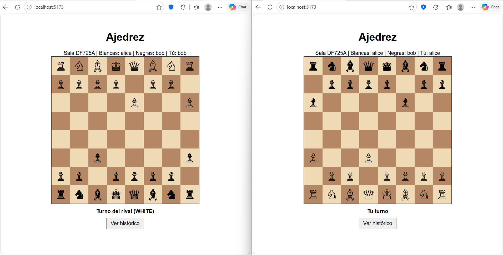

**Sala**

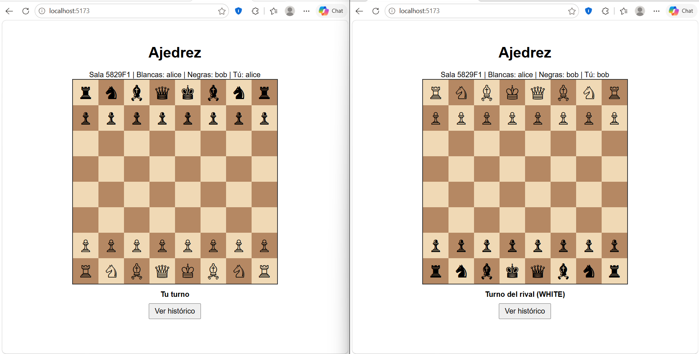

**Histórico registrado** (reproductor de partidas)

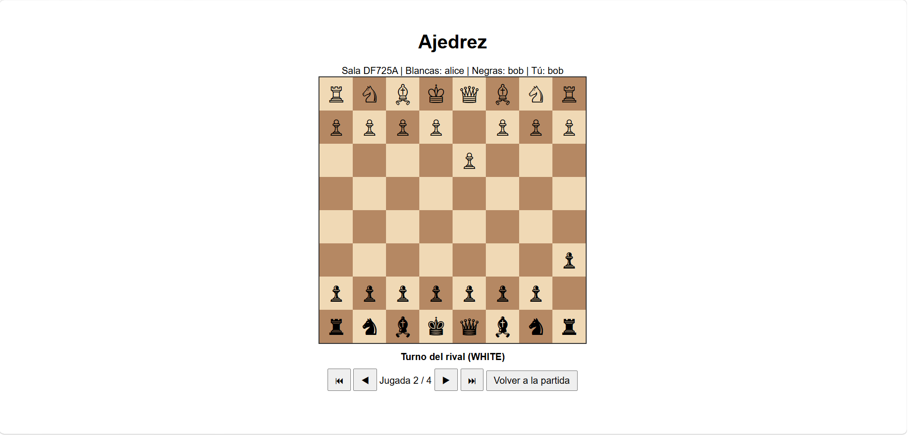

**Error mostrado en la interfaz**

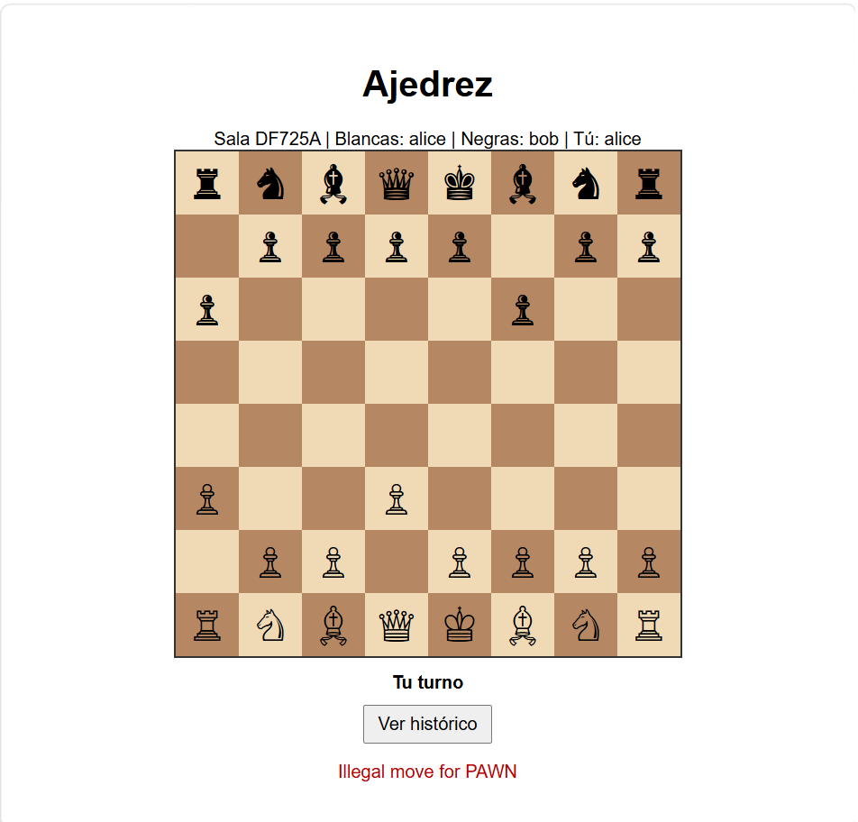

### Capturas backend

**Crear sala y unirse (API)**

![Crear partida y unirse desde el backend][crear-sala-y-unirse.png](screenshots/crear-sala-y-unirse.png)

**Registro de movimientos desde el backend**

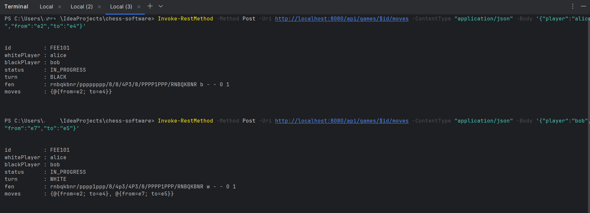

**Persistencia tras reiniciar el backend**

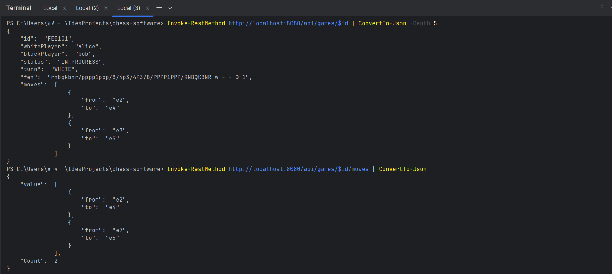
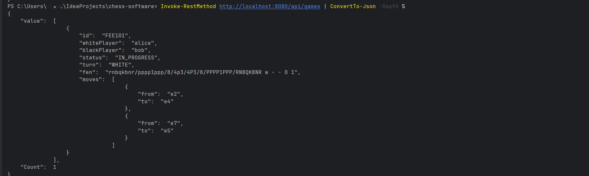

**Casos de error**

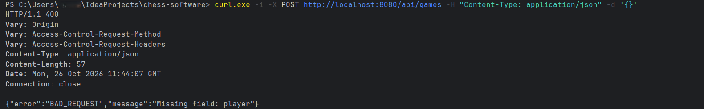
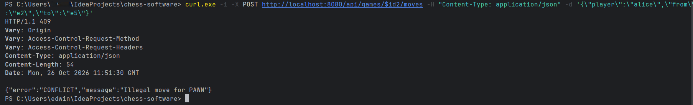
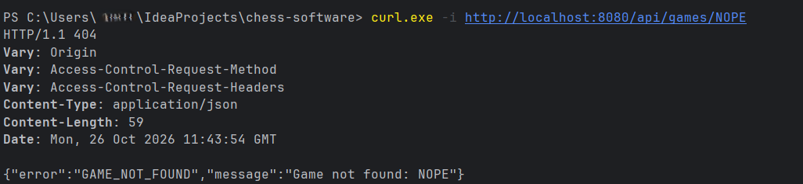
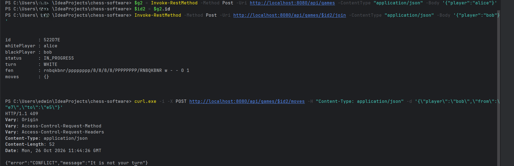

**Tests**

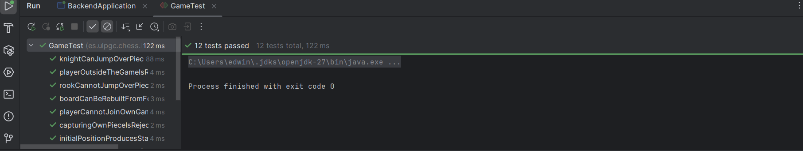

**Tests del frontend**

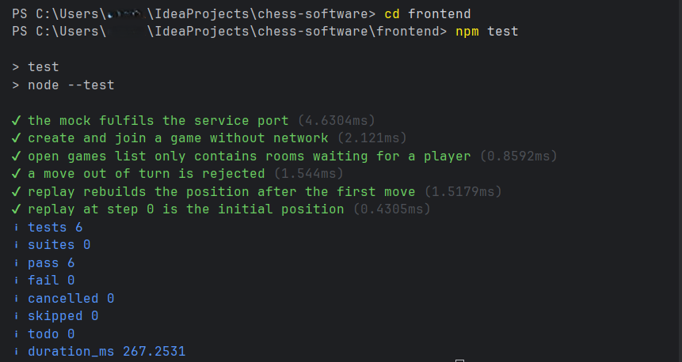

## Límites conocidos

- Las partidas se guardan en una base de datos H2 en fichero local; no está pensada para producción
- Los movimientos se guardan como texto en una sola columna, sin tabla propia
- Reglas de ajedrez reducidas (ver arriba)
- Sin autenticación: el jugador se identifica solo por el nombre enviado
- Los movimientos concurrentes sobre la misma partida no están sincronizados
- El frontend usa polling para ver los movimientos del rival (sin WebSocket)
- El mock del frontend no valida reglas de ajedrez ni actualiza el tablero; solo imita el contrato del servicio